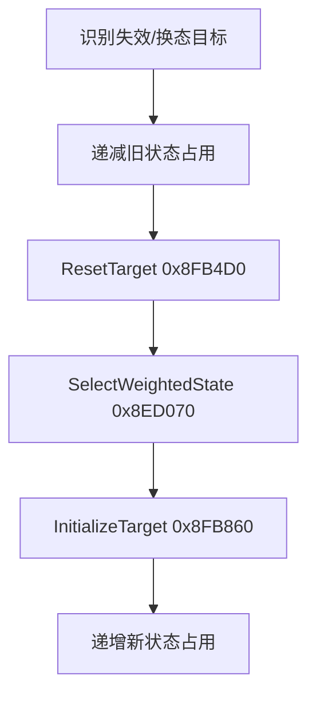
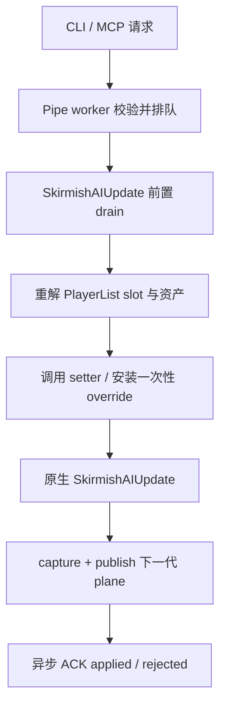

# Skirmish AI 安全写入与控制面研究

核对日期：2026-10-17（Asia/Shanghai）。目标是 SHA-256
`dc54c54aa40d48bf2605cd5616f01e19fb1b3859b9dbe03dfa6dc28e6921e4b0` 的 x86
`Data/ra3_1.12.game`，IDA image base 为 `0x00400000`。本文记录本轮只读 IDA
分析、官方 Skirmish AI XML/schema 对照和 RA3MCP 现有 hook 架构审计的结果。

本文是实现前设计证据，不表示下列写操作已经在 RA3MCP 中开放。当前发布版 AI
接口仍只有只读 `probe`；鼠标控制协议不受本文影响。

| 文档 | 内容 |
| --- | --- |
| [AI_PROBE.md](AI_PROBE.md) | 当前已实现的异步只读 plane、JSON 字段和 v3 协议 |
| [AI_CONTROL.md](AI_CONTROL.md) | 原生写入口、生命周期约束、安全分级与候选 CLI/MCP 控制面 |
| [REVERSE_ENGINEERING.md](REVERSE_ENGINEERING.md) | 目标版本、地址约定和当前已落地 hook |

## 1. 结论

游戏没有一个可以让外部进程随意改字段而仍保持一致性的“AI 控制 table”。它有两层可利用的原生结构：

1. `AIPersonalityDefinition`、战略/预算/建造状态、启发式和战术等由 SAGE 资产系统加载到全局 Store；它们是共享定义，不是每个 AI 的可变控制块。
2. `SkirmishAI` 及其 Bank、StateManager、TargetManager、TacticManager 保存每个玩家的运行时状态，并通过原生函数维护引用、占用计数、计时器、队伍和战术生命周期。

因此可靠写入的原则是：**外部线程只排队；游戏逻辑线程重新解析 Player 和资产身份；只调用原生状态转换函数，或在原生选择边界消费一次性 override；调用后再从 plane 观察结果。**

当前最适合第一批控制的四个动作是：

- 通过原生 setter 修改战略指令。
- 选择当前 Personality 已持有的预算定义并通过原生 Bank 函数应用。
- 在原生候选集合内一次性指定“下一次战略状态选择”。
- 请求目标按原生清理、选态和初始化路径重新选择。

不应直接写战略分数、vector 边界、目标/战术指针、银行账户 float 或共享 Personality 资产。局中热换 Personality 也没有完整、安全的重建证据。

## 2. 证据范围与置信度

| 等级 | 含义 |
| --- | --- |
| 已验证 | 反编译、汇编/交叉引用和现有运行时对象布局相互吻合，可作为实现依据 |
| 候选 | 已定位正确决策边界，但完整调用约定或所有前置条件仍需动态测试 |
| 禁止 | 已知会绕过原生不变量，或会被下一次更新覆盖，不应形成公共接口 |

所有 VA/RVA 只适用于本文固定哈希。实际地址必须使用
`GetModuleHandleW(nullptr) + RVA`，不得把 IDA VA 当成 ASLR 后的进程地址。

## 3. 外部配置、Store 与运行时实例

### 3.1 官方 XML 是设计时输入

Electronic Arts 的 C&amp;C Modding Support 数据中存在完整 Skirmish AI 资产源：

```text
Red Alert 3/Xml/SkirmishAI/Personalities/*.xml
Red Alert 3/Xml/SkirmishAI/States/*.xml
Red Alert 3/Xml/SkirmishAI/OpeningMoves/*.xml
Red Alert 3/Schemas/SkirmishAI/*.xsd
```

`AIPersonalityDefinition` schema 可引用：

- `OpeningMove`
- `StrategicState`
- `BudgetState`
- `BuildState`
- `UnitCap`、`SpecificUnitCap`
- `BuildDelay`、`BuildDelayRange`
- `ResourceMultiplierCheat`
- `UnitModifier`
- feedback、`PowerChoice`
- 最大战略目标数、威胁半径、建造阈值、排序和其他全局 AI 参数

运行时没有发现对这些 loose XML 的文件监听或热重载。XML 是资产工程的源输入，游戏实际消费经 SAGE pipeline 编译后的资产数据库/归档。修改 XML 后必须走相应的资产编译和 mod 装载流程；不能指望正在运行的原版进程自动读取。

### 3.2 全局 Store

| 对象 | IDA VA | RVA | 证据/用途 |
| --- | ---: | ---: | --- |
| `TheAIMicroManagerStore` 指针槽 | `0x00CEEA6C` | `0x008EEA6C` | 微操定义 Store |
| `TheAIPersonalityStore` 指针槽 | `0x00CEEA7C` | `0x008EEA7C` | Personality 定义 Store |
| `AIMicroManagerStoreCtor` | `0x008EA5D0` | `0x004EA5D0` | 构造微操定义 Store |
| `AIPersonalityStoreCtor` | `0x00909720` | `0x00509720` | 构造 Personality Store |
| 引擎 Store 初始化路径 | `0x00666950` | `0x00266950` | 创建并注册两个 Store |

这些 Store 是查找定义的入口，不是适合直接覆写的外部控制表。定义可能由多个 AI 共享；直接修改定义会把局部命令变成全局、非事务性的配置变更。

### 3.3 Personality 运行时关系

`SkirmishAI+0x8B0` 保存 Personality 资产引用包装对象。已确认的定义字段为：

| `AIPersonalityDefinition` 偏移 | 内容 |
| ---: | --- |
| `+0xE4` | 更新/反馈周期字段 |
| `+0xE8` | 周期性世界、经济或威胁扫描间隔 |
| `+0xEC/+0xF0` | compatible factions 数量/指针 |
| `+0x144/+0x148` | weighted structures 数量/指针 |
| `+0x154/+0x158` | strategic state 引用数量/指针 |
| `+0x15C/+0x160` | budget state 引用数量/指针 |
| `+0x164/+0x168` | build state 引用数量/指针 |

`LoadPersonalityStateLists`（VA `0x008F03A0`，RVA `0x004F03A0`）按当前阵营/难度掩码过滤三组定义，并重建战略、预算和建造运行时 state vector。已见调用者只有：

- `SkirmishAICtor`，VA `0x00913040`。
- Skirmish AI 序列化/读档路径，VA `0x0090F600`。

读档路径会重新解析 Personality 资产，并调用 `LoadPersonalityStateLists`；同时序列化 `SkirmishAI+0x8EC` 的战略指令。这证明“构造/读档重建”是原生支持的边界，但**没有证明局中热换 Personality 安全**。现有目标、活动战术、队伍、占用计数和其他管理器没有在一次已知事务中全部重建。

## 4. 已定位的原生写入口

| 类别 | 分析名 | IDA VA | RVA | 结论 |
| --- | --- | ---: | ---: | --- |
| 指令 | `SetStrategicDirective` | `0x008DDFA0` | `0x004DDFA0` | 已验证，优先使用 |
| 指令 | `SetDirectiveHighLevel` | `0x008DE0F0` | `0x004DE0F0` | 已验证的上层包装 |
| 预算 | `ApplyBudgetDefinition` | `0x008D0260` | `0x004D0260` | 已验证；只传当前资产图中的定义 |
| 状态 | `StateManagerUpdate` | `0x008C6F10` | `0x004C6F10` | 已验证；说明裸分数写入不可靠 |
| 状态 | `SelectWeightedStrategicState` | `0x008ED070` | `0x004ED070` | 候选介入点；只能从有效候选中选 |
| 建造 | `AIBuildStateManagerUpdate` | `0x008D03E0` | `0x004D03E0` | 已验证；原生选择最高分并应用预算 |
| 目标 | `AITargetManagerReselect` | `0x008FBC00` | `0x004FBC00` | 已验证生命周期路径 |
| 目标 | `ResetTarget` | `0x008FB4D0` | `0x004FB4D0` | 已验证清理路径 |
| 目标 | `InitializeTarget` | `0x008FB860` | `0x004FB860` | 已验证初始化路径 |
| 目标 | `ReplaceTargetState` | `0x008FBB40` | `0x004FBB40` | 候选显式换态入口 |
| 战术 | `ChooseTargetTactic` | `0x0090DD80` | `0x0050DD80` | 已验证选择与 `CanUse` 路径 |
| 战术 | `QueueTacticInstance` | `0x00907490` | `0x00507490` | 低层入口；暂不直接开放 |
| 战术 | `FinishTactic` | `0x008F9820` | `0x004F9820` | 已验证常规结束/拆链路径 |
| 调度 | `AIStrategyManagerUpdate` | `0x0090EA40` | `0x0050EA40` | 目标、战术和队伍的周期总入口 |

以上函数名是分析名，不是游戏导出符号。实现前仍须逐个固定精确 x86
`thiscall` 参数、返回值和被调方清栈方式，并为每个入口写原生测试夹具。

## 5. 战略指令：首选写入口

`SetStrategicDirective` 的签名语义可归纳为：

```cpp
void SetStrategicDirective(SkirmishAI* ai, int directive) {
    ai->strategicDirective = directive;      // +0x8EC
    ai->directiveObject = nullptr;           // +0x8F0
    cleanupOldDirectiveState(ai);
    publishDirectiveFeedback(ai);
    ai->directiveLimit = INT_MAX;            // +0x8F4
    ai->directiveChangedFrame = logicFrame;  // +0x8FC
}
```

整理后的枚举映射：

| 值 | 名称 |
| ---: | --- |
| `-1` | `Invalid` |
| `0` | `Normal` |
| `1` | `Assault` |
| `2` | `HoldPosition` |
| `3` | `HoldObject` |
| `4` | `Help` |

它不只写 `+0x8EC`，还清理旧指令关联对象、发出反馈并重置时序字段。因此公共控制面必须调用原生 setter，不能裸写枚举。

`SetDirectiveHighLevel` 在 directive 为 `Normal` 时先调用反馈/事件路径，再进入核心 setter。后续动态测试应比较两个入口在 Normal、Assault 和 Help 上的反馈差异；第一版可以优先复用已有上层调用者使用的包装入口。

交叉引用还包括 VA `0x005C7820`、内部扫描/状态路径 `0x008E7030`，以及上述包装函数。setter 中的反馈/事件调用落到 VA `0x009611C0`。这些 xref 证明它是游戏自身复用的状态转换入口，而不是只供构造函数使用的一次性初始化函数。

## 6. 预算与建造状态

`ApplyBudgetDefinition` 接受一个已有 BudgetDefinition，并维护 Bank 的关联状态：

```cpp
void ApplyBudgetDefinition(AIBank* bank, BudgetDefinition* definition) {
    if (bank->currentBudget != definition)
        bank->currentBudget = definition; // bank + 0xFC

    clearFivePrimaryWeights(bank);
    sum = sumNonNegativePrimaryWeights(definition);
    if (sum > 1.0f)
        normalizePrimaryWeights(bank, sum);
    else
        setSlushWeight(bank, 1.0f - sum);
    recalculateBank(bank);
}
```

六个 36 字节账户对象的基址位于 Bank 的 `+0x14`、`+0x38`、`+0x5C`、`+0x80`、`+0xA4` 和 `+0xC8`；对应 rough JSON 中的 INVESTMENT、SPECIAL_OPERATIONS、PRODUCTION、DEFENSE、TECHNOLOGY 和 SLUSH_FUND。

原生调用者包括 `AIBuildStateManagerUpdate`（VA `0x008D03E0`）和 Bank 构造路径（VA `0x00902010`）。函数末尾调用 VA `0x008CAFA0` 重算 Bank。前者重新评估 build states，选择最高分，再应用相应预算。因此外部应用预算在结构上可以安全完成，但下一次原生 build-state 更新可能覆盖结果。

公共接口应采用以下二者之一：

- 一次性应用，明确返回“可能被下一次原生评估覆盖”。
- 有限帧 lease：每次只在游戏线程确认仍处于同一 match/player/personality epoch 后续期；lease 到期自动恢复完全原生选择。

不能持续在外部线程写六个账户 float，也不能传入不属于当前 Personality 资产图的任意地址。

## 7. 战略状态评分与选择

`StateManagerUpdate` 会周期性重算每个 RuntimeAIState 的 score/flag，安排下一次评估帧，再通过 `0x008C1B40` 归一化。由此得到两个直接约束：

1. 裸写 score 会在下一次评估被覆盖。
2. 改一个 score 而不重做整个归一化，会破坏候选权重不变量。

`SelectWeightedStrategicState` 执行的不是“取最大值”，而是先过滤：

- runtime definition 必须存在；
- flag/启用条件满足；
- 状态容量和当前占用允许；
- 目标策略允许且存在可用目标；
- 其他当前上下文约束通过。

随后才按归一化 score 做加权随机。因此 LLM 最合适的介入方式是“**下一次选择 override**”：

```cpp
RuntimeAIState* SelectStateWithOptionalOverride(Context ctx) {
    candidates = BuildNativeEligibleCandidateSet(ctx);
    if (override.matches(ctx) && candidates.contains(override.assetId)) {
        consume(override);
        return candidates.byAssetId(override.assetId);
    }
    return NativeWeightedRandom(candidates);
}
```

override 必须一次性消费、有截止帧，并以稳定 AssetId 表达；不得从外部返回任意 RuntimeAIState 指针。请求的状态若不在当前原生候选集中，应拒绝并记录原因，不能退化为强行赋值。

## 8. 目标生命周期

`AITargetManagerReselect` 遍历步长 `0x2CC` 的目标记录。目标失效或需要换态时，它按以下顺序维护状态：



- `ResetTarget` 会清理字段和容器；若 `target+0x0C` 有活动 tactic，会调用常规 tactic 结束路径。
- `InitializeTarget` 从所选状态运行目标启发式，把状态写入 `target+0x08`，并在 `target+0x2C4`（十进制 708）设置选择帧等字段。
- `ReplaceTargetState` 对符合条件的目标显式换入给定 runtime state，同样负责旧/新占用计数和 reset/init。它已被 tactic 更新路径 VA `0x00906F20` 调用，但仍需动态确认其所有前置条件后才能成为公共入口。

所以“重新选目标”不能实现为清空几个 target 字段。第一版应设置一个由游戏线程消费的 reselect 请求，让完整原生生命周期执行；显式指定状态时仍必须经过当前候选/资产归属验证。

## 9. 战术生命周期

`ChooseTargetTactic` 从当前战略状态允许的 tactic set 中随机选择 definition，设置所属 AI，并通过虚表 `+0x14` 调用 `CanUse(target)`。校验成功后才进入 `QueueTacticInstance`：由 definition 虚表 `+0x10` 创建实例，连接 target/AI，并加入活动 tactic vector。

`AIStrategyManagerUpdate` 会按计划更新 TargetManager、TacticManager 和 TeamMaker，再由 `FindReadyTarget`（VA `0x008DAD80`）取得就绪目标并调用 `ChooseTargetTactic`。这条顺序说明 tactic 创建依赖同轮已经维护好的 target 和 team 状态。

`FinishTactic` 是各类 tactic 普遍复用的正常结束路径，会：

- 标记完成并执行可选虚拟清理；
- 释放队伍或其他资源；
- 更新关联 runtime strategic state 标志；
- 将目标标记为需要重新选择；
- 清除对象间链接。

这说明未来的“强制战术”最多只能在当前 state 的原生 tactic set 中选择，并仍调用 `CanUse` 和原生 queue 路径；不能由外部构造 tactic 指针或直接向 vector 追加。取消战术也应调用正常结束路径，且只在已验证生命周期状态和游戏线程中执行。

## 10. `ScoutAircraft -> StaticDefense` 对照结论

Probe 曾显示 `ScoutAircraft` 战略状态对应 `StaticDefense` tactic。官方
`Xml/SkirmishAI/States/AIStateLibrary.xml` 的配置确实如此：该状态把战斗机队伍交给
`ScoutAircraftMicroManager`，目标启发式选择最近的友军机场/建筑，并使用距离约 300
的 `StaticDefense` tactic。

这里的 `StaticDefense` 是围绕友军基地/机场巡弋和防卫的执行类，不表示把侦察机识别成防御建筑。该结果是资产设计，不是 AssetId 索引冲突、JSON 序列化错位或 target/tactic 指针读错。

## 11. RA3MCP 控制面线程模型

现有 ASI 已 hook `SkirmishAIUpdate`（VA `0x00909A90`，RVA `0x00509A90`），并在原函数返回后执行 `publishAgent(captureAgent(self))`。这个 hook 位于游戏逻辑线程，是执行 AI 写命令的正确边界。

建议的完整数据流：



实现约束：

- Pipe/MCP worker 只解析、限流和入队，绝不直接调用游戏函数。
- 以 `player_id`（PlayerList slot）寻址；执行时重新验证
  `SkirmishAI -> Player -> PlayerList[slot]` 双向关系。
- 请求只保存 AssetId、枚举和标量，不跨帧缓存 Player、definition、runtime state、target 或 tactic 指针。
- 使用 match/load epoch 和 plane generation 拒绝跨局、读档后或过期请求。
- 写入前验证当前 Personality、阵营、候选集合和对象生命周期；写入后由下一份 plane 证明结果。
- 游戏线程不得等待 pipe、文件、JSON 或 LLM；队列满时立即拒绝外部请求。
- 指令 setter/override 的 drain 宜位于原函数前；plane capture 保留在原函数后，以便 ACK 对应同一轮产生的可观测状态。

## 12. 候选命令契约

每个请求至少携带：

| 字段 | 作用 |
| --- | --- |
| `request_id` | 幂等追踪；不代表允许自动重放 |
| `player_id` | 0..19 的已验证 PlayerList slot |
| `expected_generation` | 请求依据的 plane generation；用于拒绝陈旧决策 |
| `match_epoch` | 区分新局、读档和对象重建 |
| `command` | 受限动作名称 |
| `payload` | 枚举、AssetId、target index 等稳定值 |
| `deadline_frame` | 超过指定逻辑帧后不再执行 |
| `lease_frames` | 可选；只用于明确支持的短期策略租约 |

第一批建议接口：

| 命令 | 输入 | 原生落点 | 初始限制 |
| --- | --- | --- | --- |
| `ai_set_directive` | player、directive | `0x008DDFA0` / `0x008DE0F0` | 仅合法枚举；目标 Player 必须仍是 Skirmish AI |
| `ai_apply_budget` | player、budget AssetId、lease | `0x008D0260` | 只允许当前 Personality 的 runtime budget state |
| `ai_force_next_strategy` | player、strategic state AssetId | `0x008ED070` 选择边界 | 一次性；必须在本轮原生有效候选集合内 |
| `ai_request_target_reselect` | player、target index | `0x008FBC00` 生命周期 | index、记录状态和所有权必须重新验证 |

后续才考虑：

- `ai_cancel_tactic`：走 `FinishTactic`，需先补齐实例状态验证。
- `ai_force_tactic`：只能选择当前 state 的 tactic definition，先执行 `CanUse`，再走原生 queue。

暂不开放：Personality 热换、任意 score、任意地址、任意 definition 指针、任意账户比例和任意 tactic 实例创建。

推荐的异步结果状态：

| 状态 | 含义 |
| --- | --- |
| `queued` | 外部线程已入队，尚未在游戏线程执行 |
| `applied` | 游戏线程调用了原生路径；附执行帧和随后 plane generation |
| `rejected_stale` | generation、epoch 或 deadline 已过期 |
| `rejected_identity` | player slot 双向关系不再成立 |
| `rejected_asset` | AssetId 不属于当前 Personality/runtime vector |
| `rejected_ineligible` | 状态/tactic 不在当前原生候选集合 |
| `rejected_lifecycle` | target/tactic 当前状态不允许该转换 |
| `queue_full` | 为保护游戏线程而拒绝排队 |

## 13. 安全分级

| 等级 | 动作 | 原因 |
| --- | --- | --- |
| 绿色 | 原生 setter 设置战略指令 | setter 同时维护清理、反馈和时序字段 |
| 绿色 | 原生函数应用当前 Personality 的预算定义 | 账户归一化和 Bank 重算由游戏完成；效果可能是暂时的 |
| 黄色 | 在原生有效候选中 override 下一次战略状态 | 需 hook 决策边界、一次性 token 和严格 eligibility 校验 |
| 黄色 | 请求目标按原生 reset/select/init 路径重选 | 必须维护 tactic 结束和状态占用计数 |
| 黄色 | 从当前 state 的 tactic set 选择并通过 `CanUse` 后排队 | 尚需动态验证所有生命周期条件 |
| 黄色 | 通过原生 finish 路径取消 tactic | 只能在合法活动实例上执行 |
| 红色 | 裸写 state score/flag | 会被重算，并可能破坏归一化 |
| 红色 | 写 vector begin/end/capacity | 会破坏所有权、容量和析构语义 |
| 红色 | 写 target/tactic 指针或活动 vector | 绕过占用计数、资源释放和对象链接 |
| 红色 | 外部线程循环写银行 float | 与游戏线程竞争并绕过 Bank 重算 |
| 红色 | 修改共享 AssetDefinition | 影响多个消费者，缺少事务和恢复路径 |
| 红色 | 局中热换 Personality | 只证明构造/读档重建，未证明完整运行时迁移 |
| 红色 | 从 pipe/MCP 线程直接调用引擎 | 线程亲和、容器和调度器均不安全 |

## 14. 单机、联机和确定性边界

第一版写控制面应只允许单人 Skirmish。网络/锁步对局中，本地 LLM 的响应时间、随机选择和命令到达帧都可能不同；只改一个客户端会造成确定性分歧甚至断线。

除非未来能把完全相同的确定性命令、参数和执行逻辑帧复制到所有 peer，并确认调用不消费不同的 RNG 序列，否则网络对局必须拒绝 AI 写请求。Replay 回放也应保持只读，避免污染确定性验证。

## 15. 分阶段验证计划

### Phase 0：只读基线

1. 在命令前后各导出一次 AI probe。
2. 记录 player slot、match epoch、plane generation、game frame、Personality AssetId。
3. 验证无写入时多次采样不会改变 native 决策。

### Phase 1：战略指令

1. 只接入 `ai_set_directive`。
2. 在游戏线程调用 setter，覆盖 Normal、Assault、HoldPosition、Help。
3. 验证 `+0x8EC/+0x8F0/+0x8F4/+0x8FC`、反馈和下一代 plane。
4. 验证错误 player、跨局 generation、死亡/禁用玩家和非法 enum 均被拒绝。

### Phase 2：预算

1. 只允许 probe 已列出的 budget AssetId。
2. 调用原生 apply 后核对 current budget 指针、六账户权重和重算结果。
3. 观察下一次 BuildStateManager update 是否覆盖，并验证 lease 到期自动退出。

### Phase 3：战略选择和目标重选

1. 记录原生候选集合和被过滤原因。
2. 只 override 一个当前 eligible 的 state，且 token 仅消费一次。
3. 核对旧/新状态占用、target selection frame、tactic 拆链和 plane 结果。

### Phase 4：战术

1. 先实现只读 tactic definition/instance 关联和 `CanUse` 结果观测。
2. 再测试正常 finish；最后才测试受限 force。
3. 对队伍、资源、target 链和 active vector 做退出后一致性检查。

每一阶段都应有“请求排队但游戏在读档/退出/换局”的竞态测试，以及队列满、超时、重复 request id 和 pipe 断开测试。

## 16. 尚未解决的问题

- 所有候选写函数的精确 x86 原型和异常情况下返回值仍需逐个动态确认。
- `ReplaceTargetState` 的全部 eligibility 条件及其调用者上下文尚未完整命名。
- Tactic definition 到实例的派生类构造参数、团队所有权和 RNG 消耗仍需按类验证。
- match/load epoch 的最佳原生来源尚未固定；不能只用进程 PID 或 plane generation 代替。
- 当前是否处于网络/回放模式的可靠对象链仍需定位，写控制面在此之前默认单机 opt-in。
- 预算 lease 应在 BuildStateManager 前还是后续期，需要用执行顺序实验决定。
- Personality 热换若未来确有需求，应优先研究“构造新 AI/读档重建”级事务，不复用简单指针替换。

这些问题不阻塞只读 probe，也不影响“战略指令 setter 是第一优先写入口”的结论；它们决定后续接口能否从实验功能升级为可靠公共控制面。
